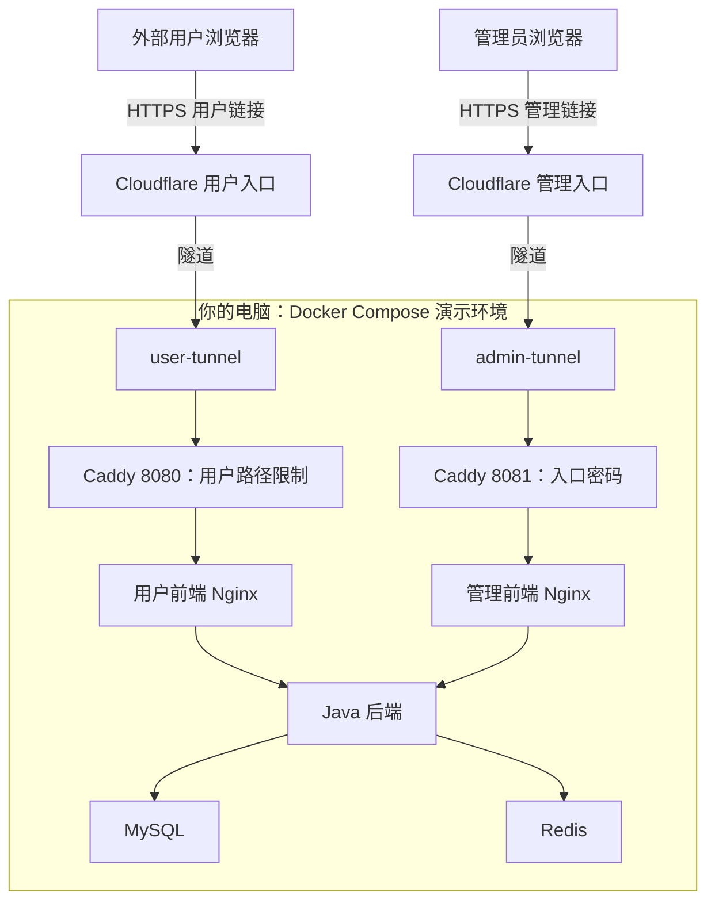

# Delivo 免费临时公网演示：技术复盘

编写日期：2026-10-08。部署及自动验证日期：2026-10-07。2026-10-08，项目作者确认已从公网成功访问。

本文回答三个问题：项目原来怎样运行；这次改了什么、得到什么效果；新增和相关文件分别写了什么、怎样配合。

**本次完成的结果：Delivo 继续在你的电脑上运行，通过两个 Cloudflare 临时 HTTPS 链接，让外部访问者分别进入用户端和受密码保护的管理端。**

文中的“改造前”主要指第一阶段本地功能已跑通、临时隧道尚未部署的时候。此前已经做过环境变量整理和公网部署准备，本文会说明哪些内容是这次新增，哪些是沿用的基础。

阅读顺序建议：第一、二节了解整体变化，第三、四节看文件，六节看文件配合，七至九节看验证结果、限制和后续工作。

### 先认识几个本文使用的词

| 名词 | 在本项目里可以怎样理解 |
| --- | --- |
| 镜像／容器 | 镜像是打包好的程序和环境；容器是它运行时的实例 |
| Compose | 一份把多个容器的配置和关系写在一起的清单 |
| 环境变量 | 从程序代码外部传入的配置，例如数据库密码、AI Key |
| 接口 API | 前端向后端发出请求的地址，用于取得数据或执行操作 |
| 反向代理 | 接住浏览器请求，代它向内部服务请求，再送回结果 |
| 数据卷 | 与容器分开保存数据的位置，容器移除后可以继续保留 |
| WebSocket | 浏览器与后端保持连接，让后端主动发来订单通知 |
| CI | 持续集成：提交代码后自动进行测试、构建和配置检查 |

## 一、项目原来是怎样的？能实现什么效果？

### 1. 原来已经有完整的业务和 Docker 配置

| 部分 | 原来的用途 | 可以实现的效果 |
| --- | --- | --- |
| 用户前端，Vue | 顾客操作界面 | 注册、登录、浏览菜单、管理地址和购物车、下单、模拟支付、与 AI 助手对话 |
| 管理前端，Vue | 店铺管理界面 | 管理菜品、套餐、员工，查看和处理订单，查看统计，接收订单通知 |
| Java 后端，Spring Boot | 执行业务规则并提供接口 | 验证登录身份、读写订单和菜品、调用 AI 服务、发送实时通知 |
| MySQL | 保存需要长期保留的数据 | 保存用户、菜品、地址、订单等 |
| Redis | 缓存及短期状态 | 保存营业状态、缓存数据、AI 对话状态等 |
| Dockerfile、Docker Compose | 构建和一起启动服务 | 在本机用容器运行上述系统 |

因此，Docker、AI 助手和下单功能在这次隧道部署之前就已经存在。本次没有重新实现这些业务。

原来的本地启动使用两份配置：

- [docker-compose.yml](../docker-compose.yml)：定义 MySQL、Redis。
- [docker-compose.prod.yml](../docker-compose.prod.yml)：补充后端和两个前端。

虽然第二个文件名字带 `prod`，本次实施前它实际仍用于本地组合启动，不能仅凭文件名判断它已经适合公开运行。

第一阶段完成后，用户端和管理端分别通过本机的 `127.0.0.1:8081`、`127.0.0.1:8082` 访问。前端容器中的 Nginx 提供网页，并将接口请求转给 Java 后端。

### 2. 当时的主要限制是外部访问与部署准备

`localhost`、`127.0.0.1` 都表示“访问者自己的这台电脑”。把你的 `localhost` 地址发给别人，他们的浏览器会尝试访问他们自己的电脑，无法因此进入你的项目。

当时已经能在本机展示完整流程，但临时公网入口尚未建立。要对外演示，还需要解决以下问题：

| 要解决的问题 | 原因 |
| --- | --- |
| 公网入口 | 外部浏览器需要一个能到达项目的地址 |
| HTTPS | 外部访问需要可用的加密网页入口 |
| 管理端保护 | 原项目有默认管理员账号；管理接口、实时通知也需要入口保护 |
| 数据隔离 | 公网演示应该使用独立的用户和订单数据 |
| 启动顺序 | 数据库进程启动后，可能还没有准备好接受连接 |
| 可重复操作 | 手工执行许多命令，容易漏配置、用错入口或忘记关闭隧道 |

## 二、做了什么改进？现在能实现什么效果？

### 1. 改造前后对照

| 方面 | 临时部署前 | 本次完成后 |
| --- | --- | --- |
| 访问范围 | 本机访问 | 外部访问者可使用临时公网链接 |
| 访问地址 | 本机 HTTP 地址 | 用户端、管理端各有一个临时 HTTPS 地址 |
| 管理端入口 | 使用应用登录；公网入口待落实 | 先通过入口密码，再使用 Delivo 管理账号登录 |
| 用户入口 | 本地开发入口 | 只将指定用户接口交给后端，阻止管理接口、真实支付和公开 WebSocket |
| 数据 | 本地开发数据 | 另建演示数据库、Redis 和 AI 缓存卷 |
| 启动操作 | 需要组合命令与手工检查 | 启动脚本生成配置、构建、启动、检查入口，再创建隧道 |
| 验证方式 | 本地功能验证 | 增加公网接口流程及停止、重启验证 |
| 日志 | 原服务日志 | 增加入口访问日志，并为演示容器设置日志轮转 |

外部访问者可以浏览菜单、注册登录、使用购物车和地址、提交模拟订单、调用 AI 助手。有管理端权限的人可以登录管理应用，查看订单，并接收管理端实时通知。

**电脑仍是运行应用的主机。** Cloudflare 提供对外访问的通道，本次没有把 Java、数据库或网页搬到云服务器上。

### 2. 实际访问链路



各组件的分工：

- **Cloudflare**：给外部浏览器提供临时域名和 HTTPS 入口。
- **cloudflared**：运行在你电脑里的隧道客户端，主动建立出站连接，让公网请求能经隧道进入本机。[Cloudflare Tunnel 原理](https://developers.cloudflare.com/cloudflare-one/networks/connectors/cloudflare-tunnel/)
- **Caddy**：根据入口和路径决定是否放行、是否要求密码，以及将请求交给哪个前端。
- **Nginx**：继续提供原来的网页文件，并将接口请求转到 Java；管理端的 WebSocket 也由它转发。
- **Java、MySQL、Redis**：继续执行原来的业务和数据读写。

图中的箭头表示请求经过的方向；隧道连接由本机主动向外建立。两个 Caddy 框代表同一个容器的两个端口，两个 Cloudflare 框代表同一平台上的两条访问入口。

例如，用户登录请求经过用户前端 Nginx 时，`/api/user/user/accountLogin` 会去掉 `/api` 前缀，转为后端的 `/user/user/accountLogin`。管理端的 `/api/employee/login` 则转为 `/admin/employee/login`。

公网浏览器到 Cloudflare 使用 HTTPS；隧道连接由 cloudflared 建立；本机 Caddy 与前端容器之间使用 HTTP。**这次的临时域名证书由 Cloudflare 提供。**

## 三、本次新增了哪些文件？写了什么、怎么写的？

本轮手工新增了 8 个主要文件：一份服务编排、一份入口配置、一份环境变量模板、四份 PowerShell 脚本、一份操作指南。

### 1. compose.demo.yml：整套演示环境的清单

文件：[compose.demo.yml](../compose.demo.yml)。格式：YAML，按照 Docker Compose 的服务配置结构编写。

它定义了 8 个服务：MySQL、Redis、Java 后端、用户前端、管理前端、Caddy、用户隧道、管理隧道。主要写入了：

| 配置 | 写入内容 | 作用 |
| --- | --- | --- |
| `name` | `delivo-demo` | 给这套演示一个独立项目名，区分网络、容器和数据卷 |
| `image` / `build` | 数据库等使用现成镜像；应用按已有 Dockerfile 构建 | 明确每个服务从哪里获得运行程序 |
| `environment` | 密码、JWT 密钥、AI Key、后端配置等 | 将配置注入对应容器 |
| `healthcheck` / `depends_on` | 检查 MySQL、Redis，后端等它们健康后启动 | 降低启动时连接尚未就绪的问题 |
| `volumes` | MySQL、Redis、AI 缓存各一个命名卷 | 容器移除后保留数据 |
| `ports` | 只有 Caddy 映射本机两个入口 | 为本地检查提供访问地址 |
| `profiles` | 两个隧道放入 `tunnel` 分组 | 可以先启动并检查应用，再单独启动公网通道 |
| `logging` | `local` 驱动，`10m`、`5` 份 | 让容器日志按大小轮转 |

下面是环境变量配置中的实际形式：

```yaml
MYSQL_PASSWORD: ${MYSQL_APP_PASSWORD:?Set MYSQL_APP_PASSWORD in .env.demo}
```

含义是：从环境变量配置取得应用数据库密码；如果没有设置，立即报错。这可以较早发现漏配。[Docker 变量说明](https://docs.docker.com/compose/how-tos/environment-variables/variable-interpolation/)

两个端口的具体含义：

```yaml
ports:
  - "127.0.0.1:18081:8080"
  - "127.0.0.1:18082:8081"
```

你的电脑通过 `18081` 进入 Caddy 的用户入口 `8080`，通过 `18082` 进入管理入口 `8081`。`127.0.0.1` 限定这些映射只能由本机直接访问。隧道容器在 Docker 网络内直接访问 `caddy:8080`、`caddy:8081`，不经过这两个宿主机映射。

数据库、缓存和 Java 后端没有单独发布宿主机端口，浏览器请求通过指定网页入口进入。命名卷实际使用 `delivo-demo_mysql_data`、`delivo-demo_redis_data`、`delivo-demo_ai_data`，分别保存三类数据。

### 2. deploy/Caddyfile.demo：两个入口的规则

文件：[Caddyfile.demo](../deploy/Caddyfile.demo)。格式：Caddy 自己的配置语法。

它写了三个部分：全局设置、用户入口 `:8080`、管理入口 `:8081`。

全局设置：

```caddyfile
{
    auto_https off
    admin off
}
```

- `auto_https off`：本机这份配置使用 HTTP，不自动为入口申请证书。
- `admin off`：关闭 **Caddy 自己的配置管理 API**。这里的 `admin` 与 Delivo 管理端是两回事，Delivo 管理页面仍然运行。

用户入口中的核心规则：

```caddyfile
handle /api/user/order/payment* {
    respond "Real payment is unavailable in this demo" 404
}
handle /api/user/* {
    reverse_proxy user-web:80
}
handle /api/* {
    respond 404
}
```

- `handle`：给一类匹配路径指定处理方式。
- `respond ... 404`：直接回复 HTTP 404，请求到此结束。
- `reverse_proxy user-web:80`：把请求转发给用户前端容器的 80 端口，再把它的响应交回浏览器。
- 真实支付使用 `payment*` 匹配，包含末尾斜杠等形式；模拟支付接口继续可用。
- 其他 `/api` 路径被阻止，普通网页请求进入用户前端。

文件还阻止用户入口的 `/ws/*`。原因是现有后端 WebSocket 没有连接鉴权；这次选择关闭公开用户 WebSocket，保留受入口密码保护的管理端实时通知。

管理入口的规则是：

```caddyfile
basic_auth {
    {$ADMIN_BASIC_AUTH_USER} {$ADMIN_BASIC_AUTH_HASH}
}
reverse_proxy admin-web:80
```

`basic_auth` 要求浏览器先提交入口账号密码，Caddy 用哈希校验；通过后才进入管理前端。这个要求覆盖管理页面、API、WebSocket。随后，Delivo 应用登录继续识别具体管理员并签发登录令牌。

两个入口还写了 `encode zstd gzip`，用于压缩响应；`log` 输出 JSON 格式访问日志，便于看到访问路径、状态码等。

### 3. .env.demo.example：需要填写什么配置

文件：[.env.demo.example](../.env.demo.example)。格式：`配置名称=配置值` 的文本。

它列出了数据库 root／应用密码、两种 JWT 密钥、两个 AI Key、Delivo 管理员密码，以及 Caddy 入口用户名、明文密码和哈希字段，并附上填写说明。

这是一份可以提交的字段模板，没有真实密钥。实际运行读取自动生成的 `.env.demo`。启动脚本自己写入配置内容，不会直接执行或自动读取这份 example 模板。

JWT 密钥用于签发和校验登录令牌，与用户输入的登录密码不同。Caddy 接收的是入口密码哈希；本地验证脚本通过保存的入口密码构造认证请求。

### 4. deploy/demo-common.ps1：脚本共用的小工具

文件：[demo-common.ps1](../deploy/demo-common.ps1)。格式：PowerShell 函数库，由其他脚本加载。

主要写了这些函数：

| 函数 | 做什么 |
| --- | --- |
| `Read-DemoEnv` | 读取简单的 `KEY=value` 配置，支持整段单／双引号 |
| `Write-DemoFile` | 以 UTF-8、LF 行尾写文件 |
| `Invoke-DemoCompose` | 统一指定演示配置和环境文件，检查命令退出结果 |
| `New-DemoSecret` | 使用加密随机数生成密码与密钥 |
| `Get-DemoHttpStatus` | 发请求并取得 HTTP 状态码 |
| `Get-DemoAdminHeaders` | 构造管理入口的 HTTP Basic Auth 请求头 |
| `Test-DemoEntrance` | 检查页面能否打开、指定接口是否受限、管理端是否要求密码 |

把相同操作放在这里，可以让启动、停止、验证脚本使用同一套路径和配置规则，减少重复编写。

例如，`Invoke-DemoCompose` 统一执行的命令前缀是：

```powershell
docker compose --env-file .env.demo -f compose.demo.yml
```

其中 `--env-file` 指定真实配置文件，`-f` 指定这次演示的服务清单。读取环境文件的函数是为本项目写的简化实现，不覆盖 Docker 支持的全部环境文件语法。

### 5. deploy/start-demo.ps1：把启动步骤串起来

文件：[start-demo.ps1](../deploy/start-demo.ps1)。格式：按顺序执行的 PowerShell 自动化脚本。

它依次执行：

1. 检查 Docker Linux 引擎可用。
2. 第一次没有 `.env.demo` 时，从原 `.env` 复制两个 AI Key，随机生成数据库密码、JWT 密钥和两组管理密码。
3. 调用 Caddy 生成入口密码的 bcrypt 哈希，写入配置和本地密码说明。
4. 校验 Compose 与 Caddy 配置。
5. 默认构建三个应用镜像；传入 `-SkipBuild` 时跳过构建。
6. 启动数据库、缓存、后端、前端和 Caddy。
7. 最多等待五分钟，通过营业状态接口确认后端能响应。
8. 检查本地入口的指定路径和密码规则。
9. 首次将演示店铺设为营业中，记录标记；后续保留已有营业状态。
10. 启用 `tunnel` 分组，启动两个隧道。
11. 从隧道日志提取最新地址，写入地址文件，输出链接和密码文件位置。

这将一次部署需要的命令、配置生成和入口检查组合成了一次操作。初次部署时，应用和本地入口检查通过后，脚本才创建公网隧道。

提取地址时选择日志中最后出现的匹配项，避免在同一个隧道容器重新启动时，把较早的地址误认为当前地址。

### 6. deploy/stop-demo.ps1：停止演示、保留数据

文件：[stop-demo.ps1](../deploy/stop-demo.ps1)。格式：PowerShell 操作脚本。

它执行带 `tunnel` 分组的 `docker compose down`，停止并移除整套演示容器和网络；随后把地址记录的 `active` 改为 `false`，写入停止时间。

命令没有添加 `-v`，因此三个命名数据卷继续保留。再次启动时数据库复用已有数据，公网隧道重新创建并获得新地址。

它停止的是整套演示。只关闭公网访问、保留本地应用运行的命令，在操作指南中单独说明。

### 7. deploy/verify-demo.ps1：自动走一遍关键业务

文件：[verify-demo.ps1](../deploy/verify-demo.ps1)。格式：PowerShell 接口流程验证脚本。

默认检查本地入口；`-Public` 从地址文件取得临时 HTTPS 链接，改用公网入口；`-SkipAi` 跳过 AI 请求。

它先检查入口权限，然后登录管理应用、创建演示用户和地址、查询菜单、加入购物车、连接管理端 WebSocket、提交订单、模拟支付、接收新订单通知，最后核对用户与管理端订单数据。

AI 检查会发送一次推荐请求，要求结果同时包含可读文字与推荐菜品卡片，降低仅看到 HTTP 成功、实际功能却失败的误判。请求和订单都使用演示内容；它不会调用真实支付接口。

脚本通过 HTTP 请求和 WebSocket 连接执行检查，成功后写摘要，最终关闭测试连接并恢复原营业状态。每次会留下测试用户、地址和模拟订单。它验证的是列出的流程，不是点击浏览器界面的完整测试，也不代表所有功能已被覆盖。

### 8. docs/free-public-demo.md：给人看的操作指南

文件：[free-public-demo.md](free-public-demo.md)。格式：Markdown。

写入了第一次启动、再次启动、找地址与密码、运行验证、查看日志、停止演示的方法，并解释数据隔离、公开范围和免费隧道限制。

Compose 给 Docker 看，Caddyfile 给 Caddy 看，脚本执行操作；这份文档让使用者知道应该运行什么、结果在哪里，以及失败后先看哪一类日志。

## 四、哪些以前的文件被修改或复用？

### 1. 本次修改的配套文件

| 文件 | 本次写入的内容 | 作用 |
| --- | --- | --- |
| [.gitignore](../.gitignore) | 忽略 `.env.demo`、`.demo/` | 避免真实配置、密码和本机记录进入提交 |
| [.gitattributes](../.gitattributes) | 增加演示 Caddyfile 的 LF 行尾规则 | 统一配置文件行尾；原有规则也规范 Linux 初始化脚本 |
| [ci.yml](../.github/workflows/ci.yml) | 增加临时 Compose、Caddy 配置校验步骤 | 后续在 GitHub 自动发现部分配置错误 |
| [README.md](../README.md) | 增加免费临时演示的入口说明和指南链接 | 从项目首页能找到操作方法 |

### 2. 前期准备过、本次沿用的文件

| 文件 | 已有内容／改动 | 本次怎样用到它 |
| --- | --- | --- |
| [.env.example](../.env.example) | 列出本地数据库密码、JWT 密钥和两个 AI Key 的配置字段 | 用于原本的本地 `.env` 配置；临时启动脚本从已填写的 `.env` 复制两个 AI Key |
| [application-prod.yml](../delivo/service/src/main/resources/application-prod.yml) | 容器内数据库、Redis 地址，JWT 密钥变量，未配置的 OSS／微信字段为空，业务日志级别 WARN | 演示 Compose 通过 `SPRING_PROFILES_ACTIVE=prod` 加载它 |
| [init-admin-password.sh](../deploy/init-admin-password.sh) | 从环境变量取得管理员密码，生成现有登录机制要求的 MD5 摘要，更新种子 admin 账号 | 空演示数据库初始化时，在建表 SQL 后执行，替换默认密码 |
| [用户前端 Dockerfile](../delivo-user-web/Dockerfile) | 增加 `VITE_PUBLIC_DEMO` 构建参数 | 演示构建设为 `true` |
| [用户 App.vue](../delivo-user-web/src/App.vue) | 演示开关为 true 时不建立用户 WebSocket | 与 Caddy 禁止公开 WebSocket 的规则配合 |
| [管理端 layout/index.vue](../delivo-admin-web/src/layout/index.vue) | 从当前网页地址生成 WebSocket URL，根据 HTTP／HTTPS 选择 ws／wss | 在随机公网域名上连接当前管理入口，不再连访问者自己的 localhost |
| [管理端 nginx.conf](../delivo-admin-web/nginx.conf) | 增加 `/ws/` 代理和连接升级头 | 让管理端实时通知经过前端 Nginx 到达后端 |
| [原有建库 SQL](../delivo/sql/delivo-db.sql) | 表结构与演示种子数据 | 仅在空的演示数据卷首次启动时导入 |
| [Java Dockerfile](../delivo/Dockerfile) | Maven 构建、Java 17 运行环境 | 继续构建同一个 Java 后端，无需重写业务 |

原本的 AI 检索代码已将缓存写入 `data/dish-embeddings.json`。这次给 `/app/data` 挂上持久卷，让已有缓存文件随数据卷保留。

前期还补过营业状态为空时返回 `0` 的处理，减少新 Redis 中尚无状态导致的问题；AI 控制器减少完整聊天消息及内部异常暴露，OSS 初始化日志不再输出完整配置。这些属于前序准备，本次继续受益。

应用管理员密码仍使用项目原有的 MD5 摘要机制，本次没有迁移它；Caddy 入口密码使用 bcrypt。二者的密码存储方式也需要区分。

### 3. 三类 Compose 文件的关系

| 配置 | 面向场景 | 本次临时演示是否加载 |
| --- | --- | --- |
| 原有两个 Compose 文件组合 | 本机开发和功能验证 | 否；仍可单独使用 |
| [compose.public.yml](../compose.public.yml) | 先前准备的 Linux 云服务器＋自有域名方案 | 否 |
| compose.demo.yml | 本机独立演示＋两个临时隧道 | 是，单独加载 |

先前的 [deploy/Caddyfile](../deploy/Caddyfile)、[.env.public.example](../.env.public.example)、[public-demo-deploy.md](public-demo-deploy.md) 是云服务器路线的配套。本次不会读取它们。

新增 `compose.demo.yml` 的原因是：本次需要独立演示数据、两个无需域名的隧道、本机 HTTP 双入口和不同的启动顺序。把这些内容单独写成一个能独立运行的配置，更容易理解和维护。

## 五、运行时还生成了哪些本机文件？

这些是执行脚本后的实际配置和记录，不应作为项目源码上传。

| 本机文件 | 保存什么 | 谁生成 |
| --- | --- | --- |
| `.env.demo` | 本次演示实际使用的密码、JWT 密钥、AI Key 等 | 首次启动脚本 |
| `.demo/credentials.txt` | 浏览器入口和 Delivo 管理应用的两组账号密码 | 首次启动脚本 |
| `.demo/urls.json` | 两个链接、记录时间及 active 状态 | 启动／停止脚本 |
| `.demo/shop-initialized` | 已完成首次开店的标记 | 启动脚本 |
| `.demo/last-check.json` | 最近一次流程检查成功的时间、是否公网、订单及 AI 检查摘要 | 验证脚本 |
| `.demo/lifecycle-check.json` | 本次停止／重启检查的结果摘要 | 部署时额外执行的生命周期检查 |

它们位于项目根目录的私有配置或 `.demo/` 文件夹，已被 Git 忽略。实际业务数据在 Docker 命名卷中，不在这些 JSON 文件里。

`urls.json` 是保存的地址记录，不是实时在线状态探测；`last-check.json` 只在成功时更新，后续失败可能仍留下上次记录。阅读时应结合记录时间和当次终端结果。

## 六、这些文件怎样配合完成一次部署？

### 1. 配置的传递

第一次运行时，配置关系是：

**原 `.env` 的两个 AI Key → 启动脚本生成 `.env.demo` → Compose 将对应变量传入各个容器。**

Java 使用数据库、JWT 和 AI 配置；MySQL 使用初始化密码；Caddy 使用入口用户名和密码哈希。前端不接收 AI Key。

文件需要由对应程序读取才能生效：

| 谁读取 | 读取什么 | 得到什么 |
| --- | --- | --- |
| PowerShell 启动脚本 | `.env`、共用函数库 | 第一次生成演示配置，执行统一操作 |
| Docker Compose | `.env.demo`、`compose.demo.yml` | 服务定义和要注入各个容器的环境变量 |
| Docker 构建程序 | 三份已有 Dockerfile | 后端、两个前端的镜像 |
| Spring Boot | 基础应用配置、`application-prod.yml`、容器环境变量 | 后端实际连接及业务配置 |
| MySQL 初始化程序 | 建库 SQL、管理员密码脚本 | 第一次启动空库时的表、种子数据和新 admin 密码 |
| Caddy | `Caddyfile.demo`、自己的容器环境变量 | 路径规则、入口密码和代理目标 |
| 验证脚本 | 共用函数、演示配置、可选的最新地址文件 | 调用正确入口并检查指定流程 |

因此，Java 并不直接读取根目录的 `.env.demo` 文本；Compose 将选定配置传到容器环境后，Java 才取得它们。

已有 `.env.demo` 后，脚本会直接使用它，不会每次重新生成密码，也不会自动同步原 `.env` 中修改后的 AI Key。

这也解释了“文件里配置了 Key”与“后端正在使用这个 Key”之间的区别：必须让本次 Compose 读取正确的文件，并让后端容器接收更新后的环境。

### 2. 构建、运行和入口规则

Dockerfile 决定“怎样把程序打包成镜像”；Compose 决定“镜像怎样一起运行”；Caddyfile 决定“访问进来后怎样处理”。

`VITE_PUBLIC_DEMO` 属于前端构建参数，构建时进入网页代码；后端 AI Key 等属于容器运行配置。两种配置生效的阶段不同。

数据库和 Redis 由健康检查提供启动信号，Java 后端在它们通过检查后启动。之后，脚本还会请求业务接口并检查入口，再创建隧道。[Docker 启动顺序说明](https://docs.docker.com/compose/how-tos/startup-order/)

### 3. 三个命令各做什么？

在项目根目录运行：

```powershell
./deploy/start-demo.ps1
./deploy/verify-demo.ps1 -Public
./deploy/stop-demo.ps1
```

- 第一个准备和启动系统，记录临时链接。
- 第二个通过公网入口执行关键流程检查，会产生演示数据和 AI 用量。
- 第三个关闭整套演示，保留命名数据卷。

程序已有可用镜像时，可以通过 `start-demo.ps1 -SkipBuild` 再次启动。更新前端构建参数或代码后，应重新构建对应镜像。

## 七、实际验证了什么？结果有什么依据？

| 验证层次 | 本次做了什么 | 已取得的结果 |
| --- | --- | --- |
| 配置检查 | 校验 Compose 服务定义、Caddy 配置及脚本语法 | 配置可解析，脚本语法检查通过 |
| 本地入口检查 | 检查指定网页、管理 API、真实支付和 WebSocket 路径的状态码 | 用户页面可访问；受限路径被阻止；管理入口无密码返回 401 |
| 公网关键流程 | 通过临时 HTTPS 地址执行注册、菜单、地址、购物车、模拟订单、管理订单查询、通知及 AI 推荐 | 流程通过，AI 返回文字和菜品卡片；2026-10-07 留有最近成功摘要 |
| 业务单元测试 | 在 Java 17 Docker 构建环境中单独运行现有 Maven 测试 | 32 项通过，失败、错误、跳过均为 0 |
| 停止与重启 | 关闭演示，再启动；检查旧链接、新链接、订单和 AI 缓存 | 旧入口停止服务；新地址产生；模拟订单与缓存保留 |
| 外部访问确认 | 项目作者实际从公网访问 | 2026-10-08 反馈成功 |

业务单元测试与公网流程验证是两类证据：前者检查部分业务代码，后者检查应用、入口、数据及网络链路能否一起完成指定操作。

Java Dockerfile 打包时使用了 `-DskipTests`；32 项测试是在单独的 Maven 测试步骤中运行，不能把“镜像构建成功”自动等同为“测试通过”。

本次还用少量路径变体检查了入口限制，包括支付路径的尾斜杠、编码斜杠、带分号形式，以及尝试跨路径进入管理接口。这属于针对已知入口风险的检查，不能作为全面安全审计。

用户外网访问成功说明实际外部链路可用；不同地区、浏览器、所有 UI 功能和高并发能力仍未因此得到完整证明。

### 实施中遇到的几个问题

| 现象 | 原因／处理 | 复盘得到的经验 |
| --- | --- | --- |
| Docker 能显示版本，但无法连接引擎 | Docker Desktop 后台未运行；定位用户安装位置并启动，再使用具备引擎访问权限的正常用户环境执行命令 | 命令工具安装成功与容器引擎可用需要分别确认 |
| 本机 Maven 测试遇到依赖缓存权限问题 | 本次改用 Java 17 Docker 构建环境单独运行 Maven 测试，32 项通过；本机缓存权限问题没有在此步骤修复 | 使用与目标构建环境一致的环境取得验证结果，并说明本机的实际限制 |
| 测试结束时 WebSocket 强行断开产生 EOF 日志 | 验证脚本改为优先正常关闭连接，超时再中断 | 自动化验证也要清理测试连接，减少自身制造的异常日志 |

## 八、这次方案的边界和维护注意事项

1. **应用依赖本机在线。** 电脑休眠、断网、关闭 Docker 会影响访问；演示配置没有自动重启策略，通常需要重新运行启动脚本。
2. **链接是临时的。** 隧道重新创建后域名变化，分享前以新生成的地址为准。Quick Tunnel 不要求 Cloudflare 账号或自有域名，没有可用性保证，最多 200 个同时进行的请求，不支持 SSE；当前 AI 使用普通 JSON 请求。[Cloudflare 官方说明](https://developers.cloudflare.com/tunnel/get-started/quick-tunnels/)
3. **AI 仍可能产生费用。** 隧道服务免费，AI 按供应商规则计费。缓存持久化可以减少重复生成菜品向量的机会，现有加载代码仍会调用 embedding 服务，不能承诺启动不产生任何 AI 调用。
4. **演示保留模拟支付，用户 WebSocket 被关闭。** 管理端通知经过密码入口；真实微信支付和未配置的 OSS 上传没有在本次补齐。
5. **持久卷不等于异地备份。** 已验证停止、重建容器后数据保留，未完成电脑或 Docker 数据损坏时的备份恢复方案。
6. **日志轮转不等于监控告警。** 当前可以查看日志并限制积累，尚无自动告警和集中监控。业务 WARN 配置减少输出，不代表所有敏感日志调用都已从源码删除。
7. **配置更新需要区分文件与存储。** 修改原 `.env` 不会自动覆盖 `.env.demo`；修改 `.env.demo` 的应用管理员密码也不会自动更新已初始化数据库。勿通过删卷来随意处理密码变化。
8. **脚本是操作自动化。** 启动检查不保证 AI 检索加载和全部功能已经就绪；公网流程要另行验证。启动失败不会自动清理所有已启动服务，已运行的隧道也不会因入口检查失败自动关闭，必要时应明确停止它们。
9. **镜像和端口仍有维护成本。** 当前使用 `cloudflared:latest` 等镜像标签，未来重新拉取可能变化；本机 `18081/18082` 被占用时也需要处理冲突。

## 九、GitHub Actions 目前完成到哪里？

工作流已经写入后端单元测试、两个前端构建，以及云服务器／临时演示的 Compose 和 Caddy 配置检查。其触发条件为 push、pull request 和手动运行，检查使用占位配置，不需要将真实演示密钥提交进仓库。

**本文初稿写作时尚未推送并验证 GitHub 上的实际运行。** 上文的验证依据是本地执行和保存记录；后续 CI 状态以 [GitHub 运行记录](https://github.com/ToxicCalvin/delivo/actions/workflows/ci.yml) 为准，具体操作见 [CI 使用说明](continuous-integration.md)。

工作流当前负责持续集成检查；GitHub 云端运行器没有配置控制你的电脑，也没有自动创建这台电脑上的临时隧道。它目前没有提供自动部署到长期公网环境的流程。

验证 CI 时，应先检查提交内容，再推送并查看对应提交的运行结果；失败后根据日志修复并重新检查。

## 十、这次积累了哪些可以讲清楚的经验？

可以用下面这段话概括本次工作：

> 为 Java／Vue 全栈作品配置 Docker Compose 独立演示环境，通过 Cloudflare Quick Tunnel 提供用户和管理端 HTTPS 入口；实现入口密码与接口范围限制，配置环境变量、数据持久化和日志轮转，编写 PowerShell 启动、停止与公网流程验证脚本，完成 32 项业务单元测试及模拟订单、管理通知和 AI 推荐验证。

面试中可以进一步解释：为什么两种入口需要不同规则；为什么 HTTPS 在 Cloudflare 终止、本机 Caddy 使用 HTTP；为什么创建独立数据卷；为什么启动容器后还要检查业务接口；以及临时公网演示有哪些运行限制。

这次成果证明了你能把已有应用组织成一套可操作、可验证的公网演示流程。Linux 云服务器、SSH 运维、稳定域名、长期自动部署和备份恢复，仍是后续可以继续补充的经验。
